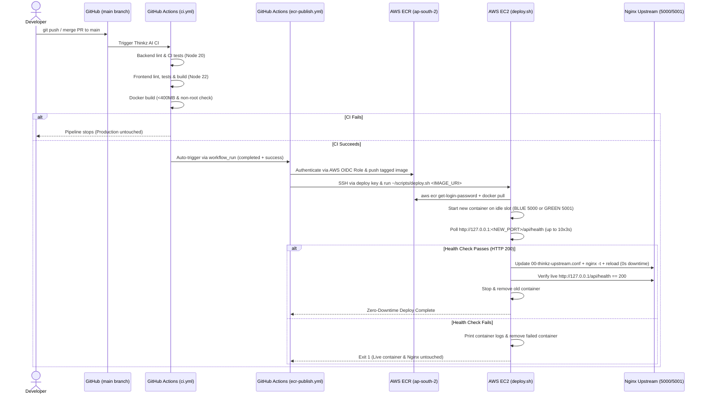

# Thinkz AI — CI/CD Pipeline & Zero-Downtime Blue-Green Architecture

**CI/CD Platform:** GitHub Actions (`.github/workflows/ci.yml` & `.github/workflows/ecr-publish.yml`)
**Deployment Strategy:** Zero-Downtime Blue-Green Deployment via Nginx Upstream (`5000` ↔ `5001`)
**Container Registry:** AWS ECR (`ap-south-2` / `thinkz-prod-api`)
**Target Server:** AWS EC2 `ThinkzAI-Prod-App` (`40.192.27.248`)

---

## 1. End-to-End CI/CD Sequence Diagram

---

## 2. Pipeline Workflows

| Workflow File | Trigger | Purpose |
|---|---|---|
| `.github/workflows/ci.yml` | Push & PR to `main`, manual dispatch | Runs Backend Quality, Frontend Quality, and Backend Docker Build checks (`<400 MB`, non-root user) |
| `.github/workflows/ecr-publish.yml` | Automatic on `Thinkz AI CI` success on `main` push, or manual dispatch | Assumes AWS OIDC role (`ThinkzAI-GitHub-ECR-Push`), pushes image to ECR, and deploys to EC2 via SSH |
| `.github/workflows/aws-auth-check.yml` | Manual dispatch | Verifies GitHub OIDC → AWS IAM connectivity |

---

## 3. Zero-Downtime Blue-Green Rollback Procedure

- **Automatic Rollback:** If the new container fails `/api/health` on the idle port (or if the post-reload live check fails), `~/scripts/deploy.sh` prints the container logs, restores the previous Nginx upstream port, removes the failed container, and leaves live users unaffected.
- **Manual Rollback:** Re-run `~/scripts/deploy.sh <PREVIOUS_ECR_IMAGE_URI>` on EC2 to switch back to any previous verified ECR image with zero downtime.

---

## 4. Required GitHub Repository Secrets

| Secret Name | Purpose |
|---|---|
| `EC2_HOST` | Public IP of `ThinkzAI-Prod-App` (`40.192.27.248`) |
| `EC2_USER` | SSH user (`ubuntu`) |
| `EC2_SSH_KEY` | Base64-encoded dedicated ed25519 deploy private key |
